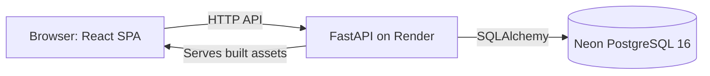

# TaskLane

[](https://github.com/LE0ST/tasklane/actions/workflows/ci.yml)
[](https://tasklane-app.onrender.com)
[](https://github.com/DataTalksClub/ai-dev-tools-zoomcamp)

TaskLane is a lightweight Kanban board for organizing work across five clear stages. Built as an educational full-stack project, it brings together a React interface, a validated API, persistent storage, automated delivery checks, and local observability.

## Live demo

Try the [TaskLane board](https://tasklane-app.onrender.com) or explore its [interactive API documentation](https://tasklane-app.onrender.com/docs). The first request may take longer if the service has been idle.

> [!WARNING]
> **This is a public, shared board with no authentication or user isolation.** Anyone can view, create, edit, move, or delete other visitors' tasks through the application or API. Do not enter credentials, personal information, or other sensitive data.

## Key features

- Track work through **Backlog → To Do → In Progress → Review → Done**. New tasks always start in Backlog; board buttons move them one stage at a time.
- Create and delete tasks, search titles and descriptions, and filter by priority. The API also supports status filtering and partial task updates.
- Validate input and return tasks in a deterministic newest-first order. The [OpenAPI contract](openapi.yaml) describes the endpoints and responses.
- Run the application locally with PostgreSQL in Docker Compose, or use SQLite for standalone backend development.

## Technology stack

| Area | Technologies |
|---|---|
| Frontend | React 19, Vite, CSS |
| API and persistence | FastAPI, Pydantic, SQLAlchemy, Alembic, PostgreSQL 16; SQLite for local development |
| Delivery | Docker, Docker Compose, GitHub Actions, Render, Neon |
| Testing | pytest, PostgreSQL integration tests, Playwright |
| Local observability | OpenTelemetry, Prometheus, Loki, Tempo, Grafana |

## Architecture overview



A multi-stage Docker build packages the frontend with the FastAPI service. Alembic migrations run at application startup. The optional telemetry and on-call stacks run locally and are separate from the public deployment. See the [architecture guide](docs/architecture.md) and [operations runbook](docs/operations-runbook.md) for topology, historical deployment evidence, and recovery boundaries.

## Quick start

### Docker Compose

With Docker and Compose installed, run from the repository root:

```bash
docker compose up --build
```

Open [http://localhost:8000](http://localhost:8000). Compose starts the app and a local PostgreSQL 16 database. Stop the stack with `docker compose down`; its named database volume remains available for subsequent runs.

### Standalone development

Install Python 3.10+ and [uv](https://docs.astral.sh/uv/), plus Node.js 20+ and npm. In one terminal:

```bash
cd backend
uv sync --frozen
uv run uvicorn main:app --reload --port 8000
```

With `DATABASE_URL` unset, the backend uses local SQLite. In another terminal:

```bash
cd frontend
npm ci
npm run dev
```

Open [http://localhost:5173](http://localhost:5173). The development client calls the backend at `http://localhost:8000` by default; `VITE_API_BASE_URL` can override it. See [.env.example](.env.example) for configuration. Never commit real credentials.

## Testing and CI/CD

Run the backend tests that do not require PostgreSQL:

```bash
cd backend
uv sync --frozen
uv run pytest -v -m "not integration"
```

PostgreSQL integration tests require a local test database; browser tests use Playwright. Setup and operational details are in the [runbook](docs/operations-runbook.md) and [CI workflow](.github/workflows/ci.yml).

The four CI jobs build the frontend, test the backend and responder with PostgreSQL integration, exercise Docker and Playwright, and verify the local telemetry and alert drill. For the evaluated commit `237fb2ca836b5f475519f92333b4fbe0c04ab850`, [CI run 40639833135](https://github.com/LE0ST/tasklane/actions/runs/40639833135) passed all four jobs. Historical release and test-count evidence is retained in the [traceability matrix](docs/evidence-traceability.md). Render's documented configuration deploys `main` after checks pass; no separate staging-to-production promotion is claimed.

## Observability and incident response

An optional local stack correlates metrics, logs, and traces using OpenTelemetry, Prometheus, Loki, Tempo, and Grafana. A local drill exercises a real task-operation 5xx alert and its recovery. See the [observability guide](docs/observability.md) and [incident drill](docs/incident-drill.md).

The local on-call overlay receives a real Grafana alert and performs **read-only diagnosis**. A separate deterministic mock drill demonstrates fixture repair. Separately, the maintainer reports a live-provider diff that was reviewed and approved by a human and applied in a disposable workspace; that report was not independently verified. An integrated flow in which a real alert triggers autonomous AI repair and verifies recovery has **not** been demonstrated. Details and evidence boundaries are in the [on-call drill](docs/oncall-drill.md).

## Project overview & evolution

TaskLane evolved from a spec-first application into a containerized deployment with automated checks and local incident drills. It demonstrates API contract design, database migrations, end-to-end testing, deployment, telemetry correlation, and evidence-based limits on AI-assisted operations. Its [engineering process](docs/process.md) and [agent roles](docs/teams.md) document the human-governed workflow.

## Project results and acknowledgments

TaskLane was the final Project 1 for [DataTalks.Club's AI Dev Tools Zoomcamp 2026](https://github.com/DataTalksClub/ai-dev-tools-zoomcamp). The maintainer reports that Project 1 passed with **30 total points** and **21/24 technical points**, three peer reviews were completed, and the official course certificate was obtained. These results have not been independently verified against the course platform.

## Documentation

- [Product specification](_docs/specs.md) and [OpenAPI contract](openapi.yaml)
- [Architecture](docs/architecture.md), [operations and recovery](docs/operations-runbook.md)
- [Observability](docs/observability.md), [incident drill](docs/incident-drill.md), [on-call drill](docs/oncall-drill.md)
- [Agent instructions](AGENTS.md), [team roles](docs/teams.md), [engineering process](docs/process.md)
- [Roadmap](docs/project-roadmap.md), [evidence and traceability](docs/evidence-traceability.md), [submission checklist](docs/submission-checklist.md)
- [Public issue tracker](https://github.com/LE0ST/tasklane/issues)
