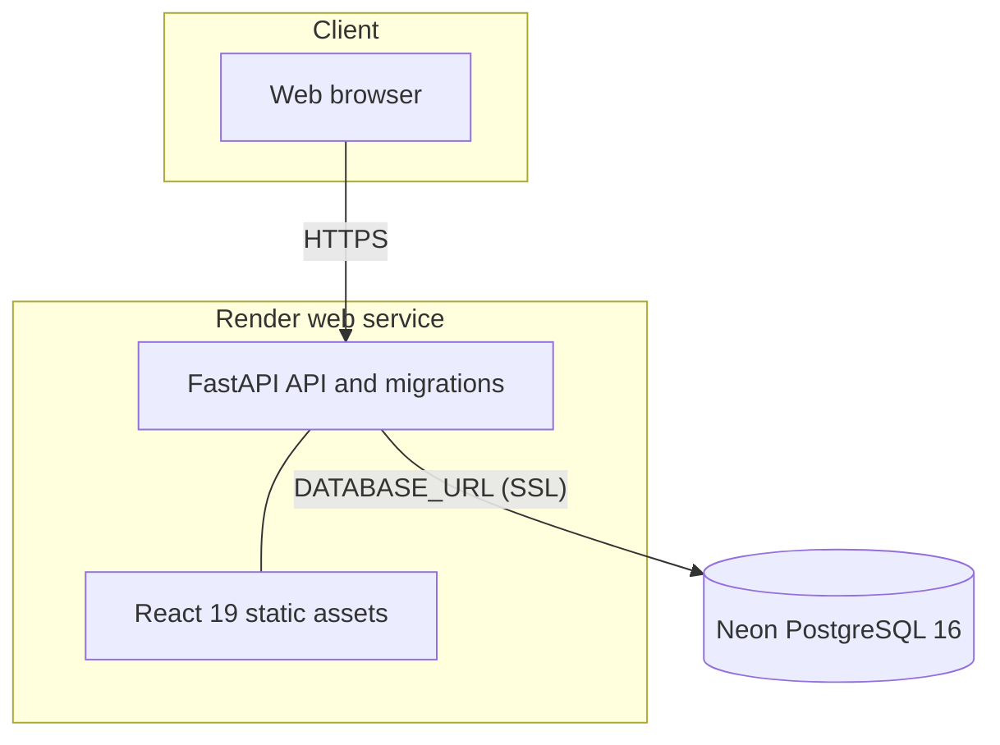
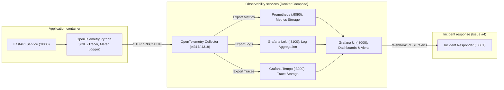

# TaskLane — System Architecture & Infrastructure

This document describes the concrete, verified system architecture, component boundaries, and infrastructure topology of **TaskLane** for **Project 1 (AI Dev Tools Zoomcamp 2026)**.

---

## 1. System Topology Overview

TaskLane is an AI-assisted full-stack Kanban workflow application deployed in a modern containerized cloud environment:

Neon project `tasklane`, branch `import`, database `neondb` is the active production database. The former Render database is a historical migration source and is not part of the active request path.

---

## 2. Infrastructure Components

### 2.1 Production Hosting (Render Web Service)
- **Service Name:** `tasklane-app`
- **Public URL:** [https://tasklane-app.onrender.com](https://tasklane-app.onrender.com)
- **Runtime:** Docker Multi-stage image:
  - **Stage 1 (Frontend Builder):** Node.js 20 Alpine compiles React 19 source into production assets via Vite.
  - **Stage 2 (Runtime):** Python 3.11 slim runtime with `uv:0.12.18` installing locked dependencies from `pyproject.toml` and `uv.lock`. Static assets mounted directly to FastAPI.
- **Process Management:** Entrypoint executes `exec uvicorn main:app` to ensure POSIX `SIGTERM` signals from Render orchestrators trigger graceful shutdowns.
- **Lifespan Startup:** On container startup, FastAPI executes `run_migrations()` running `alembic upgrade head` before serving HTTP traffic.

### 2.2 Production Database (Neon Serverless PostgreSQL 16)
- **Provider:** Neon Serverless PostgreSQL
- **Project Name:** `tasklane`
- **Active Branch:** `import` *(Notice: The active production database resides on the `import` branch, NOT the default `production` branch)*
- **Database Name:** `neondb`
- **Engine Version:** PostgreSQL 16 (SSL required)
- **Connectivity:** Connects over SSL using a protected `DATABASE_URL` environment variable configured in Render's dashboard.
- **Migration & Verification Status:**
  - Production data and schema were migrated from Render's initial database into Neon's `import` branch.
  - The migration was verified live: newly created tasks persist in Neon `neondb` and are absent from the former Render database.
  - Neon removes Render Free's fixed 30-day expiration schedule, mitigating the risk of database shutdown during project submission and peer evaluation (cloud resources remain subject to standard platform service quotas and cold-start sleep behavior).

### 2.3 Former Source Database (Render Managed PostgreSQL)
- **Service Name:** `tasklane-db`
- **Role:** Former initial database source from Homework 3.
- **Status:** Served as a temporary reference source during the migration to verify that new tasks are stored in Neon `neondb` and absent from the old database.
- **Expiration:** Its scheduled expiration date was October 24, 2026; current availability has not been reverified. It is NOT a permanent backup. Neon PostgreSQL 16 (`import` branch, `neondb`) is the sole verified production database.

---

## 3. Application Architecture & Data Flow

### 3.1 Backend Application Layer (`backend/`)
- **Framework:** FastAPI with Uvicorn ASGI server.
- **Validation:** Pydantic v2 schemas (`backend/schemas.py`) enforcing strict input bounds and output serialization:
  - Task titles: 1–120 characters, stripped, non-empty.
  - Allowed statuses: `backlog`, `todo`, `in_progress`, `review`, `done`.
  - Allowed priorities: `low`, `medium`, `high`, `urgent`.
- **Database ORM:** SQLAlchemy 2.0 with declarative mapping (`backend/models.py`). Connection engine configured with `pool_pre_ping=True` to verify connection liveness prior to checkout.
- **Schema Migrations:** Alembic (`backend/alembic/`) with migration version `1ea1353bfe87_create_tasks_table.py`.

### 3.2 Frontend Application Layer (`frontend/`)
- **Framework:** React 19 Single Page Application bundled with Vite 6.
- **Styling:** CSS Modules with CSS custom properties (design tokens) for responsive layout across desktop and mobile.
- **Centralized API Client:** `frontend/src/services/api.js` encapsulates all HTTP requests to `/api/tasks`, supporting both production relative paths and local development proxying.
- **Deterministic UI Controls:**
  - 5 dedicated lane columns: Backlog, To Do, In Progress, Review, Done.
  - Explicit directional buttons (`←` / `→`) for sequential lane transitions. Buttons are dynamically disabled at lane boundaries (`backlog` cannot move left; `done` cannot move right).
  - Search filter (substring query across title/description) and priority filter (all, low, medium, high, urgent).

---

## 4. API Design & OpenAPI Contract

The application API surface comprises the formal OpenAPI 3.1 task contract alongside runtime health probe endpoints:

### 4.1 OpenAPI Contract (`openapi.yaml`)
The core task management endpoints are formally specified in [`openapi.yaml`](../openapi.yaml):

| HTTP Method | Route | Description | Request Body | Response Codes |
|:---|:---|:---|:---|:---|
| **GET** | `/api/tasks` | List tasks (newest first) | Query: `status`, `priority`, `search` | `200 OK` (`List[TaskResponse]`) |
| **POST** | `/api/tasks` | Create new task (enforced in `backlog`) | `{title, description?, priority?}` | `201 Created`, `422 Unprocessable Entity` |
| **GET** | `/api/tasks/{task_id}` | Retrieve task detail by ID | None | `200 OK`, `404 Not Found` |
| **PATCH** | `/api/tasks/{task_id}` | Update task fields / transition status | `{title?, description?, status?, priority?}` | `200 OK`, `404 Not Found`, `422 Unprocessable` |
| **DELETE** | `/api/tasks/{task_id}` | Remove task permanently | None | `204 No Content`, `404 Not Found` |

### 4.2 Runtime Health Endpoints (FastAPI)
For cloud platforms and container orchestrators, FastAPI additionally exposes unauthenticated runtime liveness probes (implemented in `backend/main.py`):

| HTTP Method | Route | Description | Response Body |
|:---|:---|:---|:---|
| **GET** | `/health` | Cloud/container health probe | `{"status":"healthy"}` |
| **GET** | `/api/health` | API alias health probe | `{"status":"healthy"}` |

### Core Contract Constraints
1. **Creation Rule:** Tasks created via `POST /api/tasks` are always placed in `backlog`. Client-supplied `status` values on creation are rejected with `HTTP 422`.
2. **Deterministic Ordering:** Tasks are sorted newest first (`created_at DESC`, `id DESC`).
3. **Database Agnosticism:** Queries use standard ANSI SQL via SQLAlchemy ORM, verified across SQLite (dev/test) and PostgreSQL 16 (CI and Neon production).

---

## 5. Telemetry & Observability Architecture (Local Issue #2 Implementation)

Issue #2 adds an **opt-in, local-only** OpenTelemetry instrumentation pipeline. Render and Neon production remain unchanged. End-to-end local trace/log/metric correlation and Grafana datasource provisioning were verified in [Actions run 40047097348](https://github.com/LE0ST/tasklane/actions/runs/40047097348). See [the demo guide](observability.md) for commands and verification boundaries:

- **Metrics:** `tasklane_http_requests_total` and `tasklane_http_duration` exported counter/histogram; labels are bounded HTTP method, templated route and status code, never task content or raw IDs.
- **Traces:** FastAPI HTTP request spans correlate with structured application logs using a unique `trace_id`; SQLAlchemy database spans are not currently instrumented.
- **Logs:** Structured request metadata linked by `trace_id` and `span_id`, with no request bodies, task titles, connection strings or credentials. The optional incident responder is now in merged [PR #9](https://github.com/LE0ST/tasklane/pull/9) (`main` squash `7c73446`). Its real local Grafana-to-responder delivery and read-only correlation have CI evidence; the separate deterministic mock repair is not a model-authored fix. No production responder deployment is claimed.
