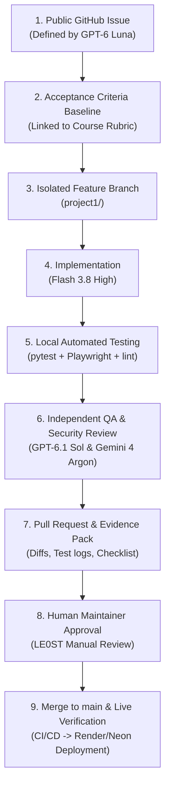

# TaskLane — AI-Assisted Engineering Process & Governance

This document establishes the verified software delivery lifecycle, agent handoff protocols, and quality gates for **Project 1 (AI Dev Tools Zoomcamp 2026)**.

---

## 1. The 9-Stage Delivery Lifecycle

Every modification to TaskLane flows through a deterministic, 9-stage engineering pipeline:



### Stage 1: Public GitHub Issue Definition
- **Owner:** GPT-6 Luna (Product & Tech Lead)
- All new tasks must be publicly tracked in the [TaskLane GitHub Issues tracker](https://github.com/LE0ST/tasklane/issues).
- Issues #1 through #5 govern Project 1 deliverables:
  - **Issue #1:** Agent team, public tracking, and modular project context.
  - **Issue #2:** Telemetry instrumentation (OpenTelemetry metrics, logs, traces).
  - **Issue #3:** Real user-impact alert and reproducible incident drill.
  - **Issue #4:** Bounded on-call responder and controlled remediation.
  - **Issue #5:** End-to-end verification, Neon persistence, and peer-review evidence pack.

### Stage 2: Acceptance Criteria Formulation
- Each issue contains an explicit checklist of testable Acceptance Criteria (AC).
- ACs cross-reference the official 12-criterion course rubric and existing technical specifications (`_docs/specs.md`).
- **No Scope Creep:** Requirements not specified in the active issue are forbidden from implementation.

### Stage 3: Isolated Feature Branching
- **Owner:** Flash 3.8 High (Implementation Engineer)
- Feature branches are created exclusively from an up-to-date `main` branch:
  ```bash
  git checkout main
  git pull origin main
  git checkout -b project1/<feature-name>
  ```
- Direct commits or pushes to `main` are strictly prohibited by documented project policy (agents must never push directly to `main`).

### Stage 4: Implementation Discipline
- **Owner:** Flash 3.8 High
- Code and documentation edits must strictly address the active issue's acceptance criteria.
- **Preservation Rule:** Existing core features, database models, schemas, and Alembic migrations must remain intact to prevent regressions.
- **Language Standard:** All source code, docstrings, variable names, documentation, commit messages, and UI text must be in **English**.

### Stage 5: Automated Verification
- Prior to submitting work for review, the implementation engineer must run:
  1. **Backend Unit/API Tests:**
     ```bash
     cd backend && uv run pytest -v -m "not integration"
     ```
  2. **Frontend Production Build:**
     ```bash
     cd frontend && npm run build
     ```
  3. **Git Hygiene & Whitespace Check:**
     ```bash
     git diff --check
     ```
  4. **Working Tree Review:**
     ```bash
     git status --short
     ```

### Stage 6: Independent QA & Security Review
- **Owner:** GPT-6.1 Sol (QA/Security) and Gemini 4 Argon (External Architecture)
- The review examines:
  - **Correctness:** Did the change satisfy every acceptance criterion?
  - **Regressions:** Are existing API contracts or frontend workflows impacted?
  - **Security & Secrets:** Are database passwords, API tokens, or internal endpoints exposed?
  - **Rubric Alignment:** Does the deliverable satisfy the target points under the official rubric?
- If deficiencies are identified, the reviewer issues specific change requests back to Flash 3.8 High.

### Stage 7: Pull Request & Evidence Pack
- When all criteria pass, a Pull Request is opened targeting `main`.
- The PR description must contain:
  - Reference to the target GitHub Issue (e.g., `Resolves #1`).
  - Summary of modified and created files.
  - Test execution logs (e.g., pytest summary, build outputs).
  - Explicit confirmation that no secrets or breaking changes were introduced.

### Stage 8: Human Maintainer Approval Gate
- **Owner:** Human Maintainer (`LE0ST`)
- The human maintainer conducts a final review of the PR diff on GitHub.
- Merges to `main` require explicit human maintainer approval by project policy. No automated process or agent may self-approve merges or bypass governance gates. Note that project policy governs agent operating rules, while any GitHub server-side branch protection settings are managed independently by the maintainer.

### Stage 9: Merge & Production Smoke Verification
- Following merge:
  1. GitHub Actions CI pipeline runs builds, tests, Compose smoke checks, and Playwright E2E scenarios.
  2. Render Web Service detects the push to `main` and initiates automatic container deployment.
  3. FastAPI lifespan executes `alembic upgrade head` against the live Neon PostgreSQL database.
  4. The maintainer verifies public health at `https://tasklane-app.onrender.com/health` and confirms data persistence.

---

## 2. Integrity & No-Fabrication Policy

- **Historical Accuracy:** Homework 2 (spec-first full-stack app) and Homework 3 (Docker, PostgreSQL, CI/CD, Render deployment) were completed prior to the formal creation of Project 1 GitHub Issues.
- **Authentic Attribution:** This documentation truthfully identifies Issues #1–#5 as the starting point of the multi-agent development workflow. No retroactive claims of prior agent orchestration are made.
- **Verifiable Trail:** Every future phase produces inspectable git diffs, PR logs, and test runs.

---

## 3. Incident Response & On-Call Drill Protocol

For Issue #3 (Alerting) and Issue #4 (On-Call Responder):
1. **Production Isolation:** Under no circumstances will artificial errors or load drills be executed against the live Render Web Service or the live Neon database.
2. **Local Disposable Environment:** All incident simulations occur inside a local, disposable Docker Compose or worktree environment.
3. **Read-Only Baseline:** Incident responders must operate in read-only diagnostic mode (`-s read-only`) by default.
4. **Remediation Sandbox:** Any automated code fix demonstration must execute in an isolated worktree with explicit authorization, bounded permissions, and no dangerous sandbox bypass flags (`--dangerously-bypass-approvals-and-sandbox` is prohibited).
5. **Sanitization:** All evidence files, trace dumps, and logs must be sanitized of host paths, environment secrets, and credentials before archiving.
