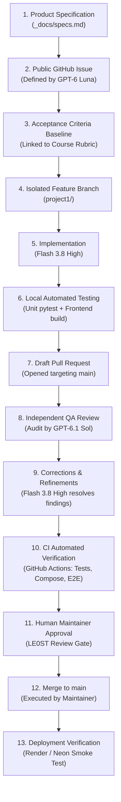

# TaskLane — AI-Assisted Engineering Process & Governance

This document establishes the verified software delivery lifecycle, agent handoff protocols, and quality gates for **Project 1 (AI Dev Tools Zoomcamp 2026)**.

---

## 1. The Verified 13-Stage Delivery Lifecycle

Every feature or operational enhancement to TaskLane flows through a deterministic, 13-stage engineering pipeline reflecting our verified workflow:



### Stage 1: Product Specification Baseline
- The canonical functional requirements and data models are defined in [`_docs/specs.md`](../_docs/specs.md). All new work must maintain compatibility with these specifications.

### Stage 2: Public GitHub Issue Definition
- **Owner:** GPT-6 Luna (Product & Tech Lead)
- Every initiative is tracked in the public [TaskLane GitHub Issues tracker](https://github.com/LE0ST/tasklane/issues) (Issues #1 through #5 govern Project 1).

### Stage 3: Acceptance Criteria Formulation
- Each issue specifies unambiguous, testable Acceptance Criteria (AC) mapped directly to official course rubric criteria.

### Stage 4: Isolated Feature Branching
- **Owner:** Flash 3.8 High (Implementation Engineer)
- Work branches exclusively from up-to-date `main`:
  ```bash
  git checkout main
  git pull origin main
  git checkout -b project1/<feature-name>
  ```
- Direct commits or pushes to `main` are strictly prohibited by project engineering policy.

### Stage 5: Implementation Discipline
- **Owner:** Flash 3.8 High
- Code and documentation edits must strictly address the active issue's acceptance criteria without scope creep or breaking existing passing features.

### Stage 6: Local Automated Testing & Verification
- Prior to opening a PR, the implementation engineer executes targeted local verification:
  1. **Backend Unit & API Tests:**
     ```bash
     cd backend && uv run pytest -v -m "not integration"
     ```
  2. **Frontend Production Build:**
     ```bash
     cd frontend && npm run build
     ```
  3. **Git Hygiene & Whitespace Check:**
     ```bash
     git diff --check
     ```
  4. **Working Tree Review:**
     ```bash
     git status --short
     ```

### Stage 7: Draft Pull Request Submission
- The feature branch is pushed to `origin`, and a **Draft Pull Request** is opened targeting `main`.
- The PR description references the active issue (`Resolves #1`), details the changes, and provides local test execution evidence.

### Stage 8: Independent QA & Security Review
- **Owner:** GPT-6.1 Sol (QA/Security) and Gemini 4 Argon (External Architecture)
- Sol conducts an independent read-only audit of the Draft PR diff, checking:
  - Acceptance criteria fulfillment.
  - Absence of credentials, secret tokens, or hardcoded sensitive connection strings.
  - Documentation portability, technical accuracy, and safety constraints.
  - Rubric alignment against the official course grading criteria.
- Findings are reported with specific verdicts (*Approve* or *Request Changes*).

### Stage 9: Corrections & Refinements
- **Owner:** Flash 3.8 High
- If findings or change requests are identified during QA review, Flash resolves them directly within the existing feature branch.
- Changes are verified locally and pushed to update the Draft PR automatically.

### Stage 10: CI Automated Verification (GitHub Actions)
- On pull request synchronization, the full GitHub Actions workflow ([`.github/workflows/ci.yml`](../.github/workflows/ci.yml)) executes:
  1. `frontend-build`: Compiles production assets with Vite.
  2. `backend-tests`: Provisions a fresh `postgres:16-alpine` service, runs Alembic migrations, and executes all 19 pytest tests (including PostgreSQL integration tests).
  3. `docker-e2e-smoke`: Builds the multi-stage Docker image, boots Docker Compose, runs HTTP smoke checks, and executes Playwright E2E browser tests in headless Chromium.

### Stage 11: Human Maintainer Approval Gate
- **Owner:** Human Maintainer (`LE0ST`)
- The maintainer inspects the resolved PR, review verdicts, and CI checks. Merging requires explicit maintainer authorization.

### Stage 12: Merge to `main`
- The human maintainer executes the merge of the approved PR into `main`.

### Stage 13: Deployment Verification
- Render automatically builds and deploys the new container from `main`.
- FastAPI lifespan runs `alembic upgrade head` against the live Neon PostgreSQL database.
- Production health is verified at `https://tasklane-app.onrender.com/health`.

---

## 2. Integrity & No-Fabrication Policy

- **Historical Accuracy:** Homework 2 (spec-first full-stack app) and Homework 3 (Docker, PostgreSQL, CI/CD, Render deployment) were completed prior to the formal creation of Project 1 GitHub Issues.
- **Authentic Attribution:** This documentation truthfully identifies Issues #1–#5 as the starting point of the multi-agent development workflow. No retroactive claims of prior agent orchestration are made.
- **Verifiable Trail:** Every future phase produces inspectable git diffs, PR logs, and test runs.

---

## 3. Incident Response & On-Call Drill Protocol

For Issue #3 (Alerting) and Issue #4 (On-Call Responder):
1. **Production Isolation:** Under no circumstances will artificial errors or load drills be executed against the live Render Web Service or the live Neon database.
2. **Local Disposable Environment:** All incident simulations occur inside a local, disposable Docker Compose or worktree environment.
3. **Read-Only Baseline:** Incident responders must operate in read-only diagnostic mode (`-s read-only`) by default.
4. **Remediation Sandbox:** Any automated code fix demonstration must execute in an isolated worktree with explicit authorization, bounded permissions, and no dangerous sandbox bypass flags (`--dangerously-bypass-approvals-and-sandbox` is prohibited).
5. **Sanitization:** All evidence files, trace dumps, and logs must be sanitized of host paths, environment secrets, and credentials before archiving.
