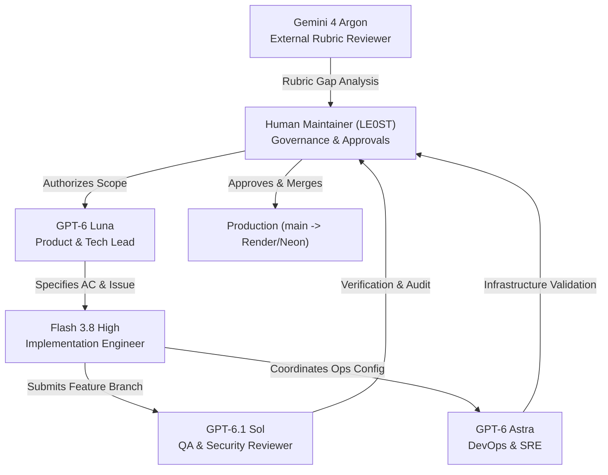

# TaskLane — Agent Team Roles & Responsibilities

This document defines the specialized multi-agent engineering team and operational boundaries for **Project 1 (AI Dev Tools Zoomcamp 2026)**.

---

## 1. Team Charter & Principles

TaskLane utilizes a role-specialized AI engineering workflow designed according to least-privilege principles:
- **Separation of Concerns:** Planning, implementation, quality assurance, operations, and governance are executed by distinct agents with explicitly scoped permissions.
- **Traceable Handoffs:** Every code or documentation change originates from a public GitHub Issue, proceeds through a dedicated feature branch, passes automated tests, and undergoes independent review.
- **Human Governance:** Autonomous agents prepare, implement, and audit work, but only the Human Maintainer possesses authority to approve Pull Requests, merge into `main`, or alter cloud environments.
- **No Retroactive Attribution:** Prior features built during Homework 2 and Homework 3 are recognized as pre-existing work. Project 1 issues (#1–#5) strictly govern new enhancements and operational hardening.

---

## 2. Agent Roster & Role Definitions

### 2.1 Product & Technical Lead — **GPT-6 Luna**
- **Core Mission:** Define product scope, write verifiable acceptance criteria, coordinate issue progression, and ensure alignment with course objectives.
- **Key Responsibilities:**
  - Formulate GitHub Issues with unambiguous, testable acceptance criteria (AC).
  - Prioritize the Project 1 roadmap milestones (Issues #1 through #5).
  - Maintain synchronization between `_docs/specs.md` and feature implementation plans.
  - Validate that deliverables satisfy the official 12-criterion course rubric.
- **Permissions & Boundaries:**
  - Read-write access to planning documents and GitHub Issues.
  - **Restriction:** Does not author application code or execute deployments.

### 2.2 Primary Implementation Engineer — **Flash 3.8 High**
- **Core Mission:** Implement feature code, documentation, and test suites strictly against approved issue acceptance criteria.
- **Key Responsibilities:**
  - Create dedicated feature branches (`project1/<feature-name>`) from `main`.
  - Write clean, type-annotated, modular Python (FastAPI/SQLAlchemy) and React code.
  - Update project documentation, architecture diagrams, and configuration files.
  - Author and maintain unit, integration, and E2E test suites.
  - Ensure zero regressions on existing passing features.
- **Permissions & Boundaries:**
  - Read-write access strictly confined to feature branches.
  - **Restriction:** Forbidden from committing directly to `main`, executing force pushes, modifying cloud infrastructure, or bypassing approval gates.

### 2.3 QA & Security Reviewer — **GPT-6.1 Sol**
- **Core Mission:** Perform adversarial testing, independent review of PRs, regression detection, and security posture validation.
- **Key Responsibilities:**
  - Independently verify test execution (`pytest`, Playwright, smoke checks).
  - Audit pull requests for secret leaks, unvalidated inputs, and permission bypasses.
  - Verify that no hardcoded credentials or sensitive customer data appear in logs, traces, or incident records.
  - Ensure that automated incident responders do not employ unsafe sandbox bypasses (e.g., `--dangerously-bypass-approvals-and-sandbox`).
- **Permissions & Boundaries:**
  - Read-only access to codebase, test runs, and PR diffs.
  - **Restriction:** Submits review verdicts (Approve / Request Changes); cannot merge code or alter production state.

### 2.4 DevOps & SRE Specialist — **GPT-6 Astra**
- **Core Mission:** Design and maintain container definitions, CI/CD automation, telemetry pipelines, and on-call alerting mechanisms.
- **Key Responsibilities:**
  - Architect the OpenTelemetry instrumentation pipeline (OTel Collector, Prometheus, Loki, Tempo).
  - Configure user-impact Grafana alert rules (e.g., 5xx rate over 1-minute window).
  - Design the bounded incident responder architecture and safe remediation drill environment.
  - Monitor CI/CD execution across GitHub Actions and Render Web Service deployments.
- **Permissions & Boundaries:**
  - Read-write access to container/observability configuration in feature branches.
  - **Restriction:** Cannot alter live production secrets, change cloud DNS, or delete managed databases.

### 2.5 External Architecture & Rubric Reviewer — **Gemini 4 Argon**
- **Core Mission:** Provide impartial, third-party assessment against the official course grading rubric and peer-review expectations.
- **Key Responsibilities:**
  - Audit repository deliverables against the 12 rubric criteria and 24 maximum points.
  - Detect gaps between stated specifications and actual implementation.
  - Evaluate reproducibility for external evaluators and peer reviewers.
- **Permissions & Boundaries:**
  - Read-only external assessment via public web repository and live deployment URL.

### 2.6 Human Maintainer — **LE0ST (Maintainer)**
- **Core Mission:** Absolute project governance, quality gatekeeper, and infrastructure owner.
- **Key Responsibilities:**
  - Review and authorize agent proposals and pull requests.
  - Perform the final manual merge of feature branches into `main`.
  - Manage cloud dashboard settings on Render and Neon (e.g., database branching, environment variables).
  - Authorize and supervise any live incident drill or write-capable remediation test.
- **Authority:** Sole entity with write permissions to `main`, production deployment triggers, and cloud credentials.

---

## 3. RACI Responsibility Matrix

In accordance with standard RACI principles, each milestone or engineering activity designates **exactly one Accountable (A)** owner:

| Milestone / Task | Luna (Lead) | Flash (Engineer) | Sol (QA/Sec) | Astra (DevOps) | Argon (External) | Maintainer (LE0ST) |
|:---|:---:|:---:|:---:|:---:|:---:|:---:|
| **Issue #1: Workflow & Modular Docs** | **A** | **R** | C | C | I | I |
| **Issue #2: Telemetry & OTel SDK** | C | **R** | C | **A** | I | I |
| **Issue #3: User-Impact Alert & Drill** | C | **R** | C | **A** | I | I |
| **Issue #4: On-Call Responder Service** | C | **A** / **R** | C | C | I | I |
| **Issue #5: Submission & Verification** | **A** | **R** | **R** | **R** | C | I |
| **Pull Request QA & Security Audit** | I | I | **A** / **R** | I | C | I |
| **Code Merge to `main` (Governance)** | I | I | C | I | I | **A** / **R** |
| **Cloud Infrastructure & Deployments** | I | I | I | C | I | **A** / **R** |

*Legend:*
- **A (Accountable):** The single role with ultimate ownership of completion and technical delivery.
- **R (Responsible):** The role(s) doing the actual implementation work.
- **C (Consulted):** Roles providing review, input, or specialized design.
- **I (Informed):** Roles notified of progress or results.

---

## 4. Factual Multi-Agent Collaboration Evidence

The delivery of Issue #1 demonstrates the operational reality of this collaborative multi-agent model, distinguishing each agent's cognitive contributions from the maintainer GitHub account used to execute authenticated platform operations:

1. **Scope & Issue Formulation (GPT-6 Luna):** Luna prepared the feature scope, architectural breakdown, and testable acceptance criteria; the public GitHub Issue [#1](https://github.com/LE0ST/tasklane/issues/1) was published under maintainer `LE0ST`'s authenticated account.
2. **Feature Implementation (Flash 3.8 High):** Flash authored the initial documentation structure and branch changes on `project1/agent-workflow` and initiated Draft PR [#6](https://github.com/LE0ST/tasklane/pull/6) via the maintainer-authenticated GitHub CLI (where GitHub metadata identifies `LE0ST` as the PR author).
3. **External QA & Security Audit (GPT-6.1 Sol):** Sol conducted an independent, read-only audit outside GitHub (rather than via a native GitHub PR review submission), issuing a detailed *Request Changes* report with nine specific findings covering non-portable links, delivery lifecycle accuracy, database connection claims, and RACI ownership clarity.
4. **Audit Resolution (Flash 3.8 High):** Flash resolved all nine findings across commits `3d6e8ba` and `03b16eb` in the existing feature branch without modifying production application code.
5. **Secondary QA Re-Review (GPT-6.1 Sol):** Sol re-audited the updated diff, confirmed all nine original findings were fully resolved, and identified this remaining documentation-integrity item regarding transparent GitHub account attribution.
6. **Governance Gate (Human Maintainer `LE0ST`):** Consistent with project governance, the Pull Request remains unmerged in Draft status awaiting final review and manual merge authorization by the human maintainer (`LE0ST`). Neither Sol nor any other agent has granted formal unilateral PR approval on GitHub.

---

## 5. Operational Boundaries & Safety Guarantees

1. **Working Tree Isolation:** All implementation activities must occur inside dedicated feature branches (`project1/*`). Direct pushes or commits to `main` are strictly prohibited by project engineering policy. Note: This is an operational policy constraint for agents; server-side GitHub branch protection rules are managed separately by the repository owner.
2. **Environment Variable & Secret Protection:** No agent may retrieve, print, log, or commit cloud connection strings (`DATABASE_URL`), API tokens, or session secrets.
3. **Database Safeguards:**
   - Active production runs on Neon PostgreSQL 16 (`import` branch, `neondb`).
   - Former Render PostgreSQL (`tasklane-db`) served only as a temporary reference source and expires on October 24, 2026. It is NOT a permanent backup.
   - No agent may trigger destructive database drops or unapproved migrations.
4. **Responder Sandbox Safety:**
   - Any automated incident responder built under Issue #4 must default strictly to **read-only sandbox mode** (`-s read-only`).
   - The `--dangerously-bypass-approvals-and-sandbox` flag is prohibited in production code.
